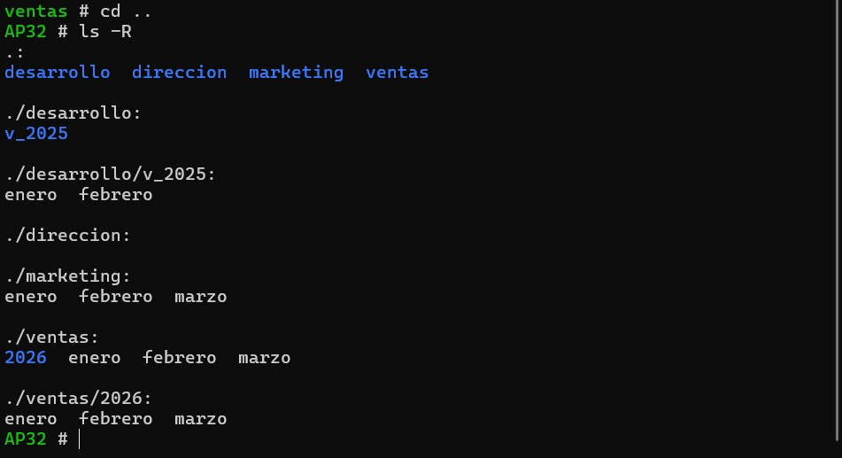

# AP32 · Gestión de directorios y ficheros en Linux

**Alumno:** Miguel Velasco Muñoz
**Curso:** 1º DAW · Sistemas Informáticos

> Año actual: **2026** · Año anterior: **2025**

---

## 1. Moverse a la carpeta de Sistemas

```bash
cd ~/daw/sistemas
```

## 2. Crear la carpeta AP32

```bash
mkdir AP32
```

## 3. Crear los subdirectorios ventas, marketing, desarrollo y direccion

```bash
cd AP32
mkdir ventas marketing desarrollo direccion
```

**¿Se puede hacer en un solo comando?** Sí. `mkdir` acepta varios nombres separados por espacios y crea todas las carpetas a la vez.

## 4. Reflexión: `mkdir a b c` frente a `mkdir a/b/c`

- `mkdir a b c` crea **tres carpetas independientes** (`a`, `b` y `c`), una al lado de la otra, dentro del directorio actual.
- `mkdir a/b/c` intenta crear **una sola carpeta `c` dentro de `a/b`**. Si `a` y `b` no existen, da error (`No such file or directory`), porque `mkdir` no crea las carpetas intermedias.
- Para crear toda la estructura anidada de golpe hay que usar la opción `-p`: `mkdir -p a/b/c`.

## 5. Crear los ficheros enero, febrero y marzo en ventas

```bash
cd ventas
echo "Ventas de enero" > enero
echo "Ventas de febrero" > febrero
echo "Ventas de marzo" > marzo
```

Se usa `echo` con redirección (`>`), que crea el fichero y escribe el texto dentro.

## 6. Desde AP32, copiar todos los ficheros de ventas a marketing

```bash
cd ..
cp ventas/* marketing/
ls marketing
```

**¿Se puede hacer con un solo comando?** Sí. El comodín `*` selecciona todos los ficheros de `ventas`. Con `ls marketing` se verifica que se han copiado:

```
enero  febrero  marzo
```

## 7. Desde marketing, crear ventas/2026 y copiar los tres ficheros

```bash
cd marketing
mkdir ../ventas/2026
cp enero febrero marzo ../ventas/2026/
```

## 8. Desde ventas, crear 2025 y copiar los ficheros de marketing que terminan en "ero"

```bash
cd ../ventas
mkdir 2025
cp ../marketing/*ero 2025/
```

El patrón `*ero` selecciona los ficheros que terminan en "ero": `enero` y `febrero` (no `marzo`).

## 9. Desde desarrollo, copiar ventas/2025 en desarrollo/ventas_2025

```bash
cd ../desarrollo
cp -r ../ventas/2025 ventas_2025
```

La opción `-r` (recursiva) copia la carpeta con todo su contenido. Como `ventas_2025` no existe, se crea con ese nombre.

## 10. Desde desarrollo, borrar ventas/2025

```bash
rm -r ../ventas/2025
```

## 11. Desde AP32, renombrar desarrollo/ventas_2025 como desarrollo/ventas2025

```bash
cd ..
mv desarrollo/ventas_2025 desarrollo/ventas2025
```

## 12. Desde ventas, renombrar el directorio anterior como desarrollo/v_2025

```bash
cd ventas
mv ../desarrollo/ventas2025 ../desarrollo/v_2025
```

---

## Comprobación final

Desde la carpeta AP32:

```bash
cd ..
ls -R
```



Resultado:

```
.:
desarrollo  direccion  marketing  ventas

./desarrollo:
v_2025

./desarrollo/v_2025:
enero  febrero

./direccion:

./marketing:
enero  febrero  marzo

./ventas:
2026  enero  febrero  marzo

./ventas/2026:
enero  febrero  marzo
```

La estructura final es la esperada:

- `ventas/2026` contiene los tres ficheros.
- `ventas/2025` ya no existe (se borró en el paso 10).
- `desarrollo/v_2025` contiene solo `enero` y `febrero`.
- `direccion` está vacía.
